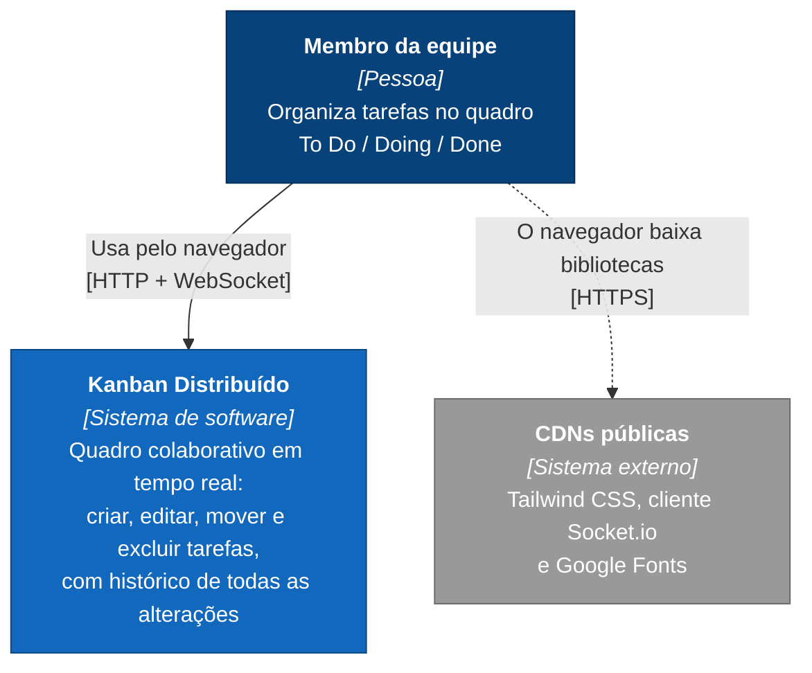
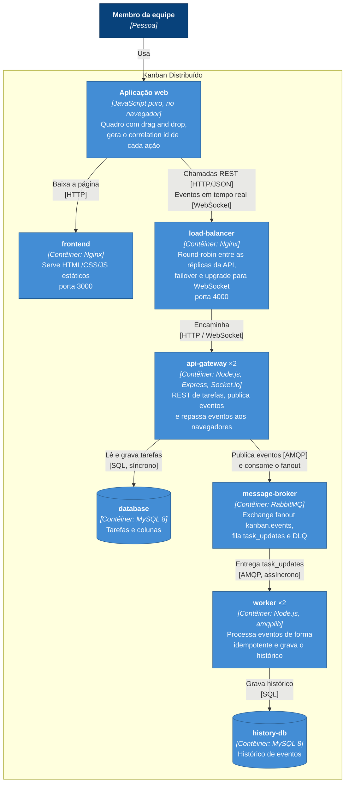
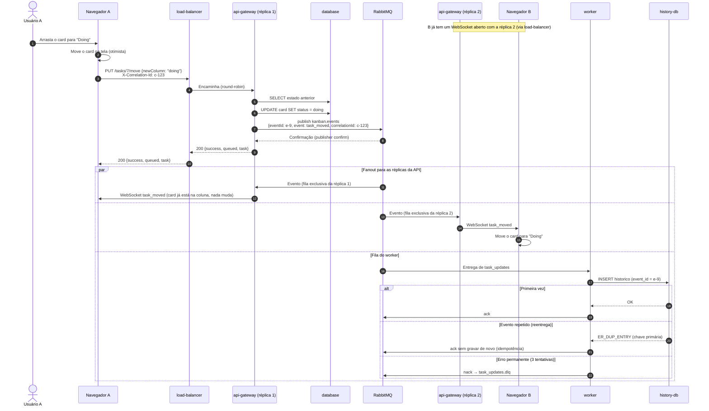

# Arquitetura

Este documento descreve a arquitetura do Kanban Distribuído no modelo C4 (níveis 1 e 2) e o fluxo principal em um diagrama de sequência. As decisões e seus trade-offs estão nos [ADRs](adr/README.md).

## Nível 1: Contexto do sistema

Quem usa o sistema e do que ele depende fora dele.



Vários membros usam o quadro ao mesmo tempo, de máquinas diferentes. Quando um deles altera uma tarefa, todos os outros veem a mudança sem recarregar a página.

## Nível 2: Contêineres

Os contêineres dentro do sistema, com tecnologia, réplicas e protocolo de cada comunicação. Tudo sobe com `docker compose up`.



| Contêiner | Responsabilidade | Estado | Réplicas | Health check |
|---|---|---|---|---|
| frontend | Servir os arquivos estáticos | — | 1 | `GET /health` |
| load-balancer | Distribuir requisições e WebSockets; failover | — | 1 | `GET /lb-health` |
| api-gateway | Regras e validação das tarefas; publicar e repassar eventos | `database` | 2 | `GET /health` |
| message-broker | Transporte assíncrono e durável dos eventos | filas duráveis | 1 | `rabbitmq-diagnostics ping` |
| worker | Histórico de alterações (processamento em segundo plano) | `history-db` | 2 | `GET :8080/health` |
| database / history-db | Persistência | — | 1 cada | `mysqladmin ping` |

A API e o worker não compartilham banco: o único caminho entre eles é o broker ([ADR 0002](adr/0002-banco-por-servico.md)).

## Fluxo principal: mover um card

O usuário A arrasta um card. O usuário B, conectado em **outra réplica** da API, vê o card se mover, e o worker registra o histórico.



Pontos principais:

* **Passos 3 a 10 são síncronos.** O usuário só recebe o 200 depois que a tarefa foi salva no MySQL e o broker confirmou o evento.
* **O restante é assíncrono.** O histórico fica em dia alguns milissegundos depois, ou alguns minutos sob carga pesada: é consistência eventual ([ADR 0004](adr/0004-consistencia-eventual-e-idempotencia.md)).
* **O mesmo `correlationId` (c-123) aparece nos logs** do load-balancer, da réplica 1, da réplica 2 e do worker.

## Contrato dos eventos

Publicados no exchange `kanban.events` (fanout, durável), com mensagens persistentes e `content-type: application/json`. O mesmo objeto é repassado aos navegadores pelo Socket.io, com o nome do evento igual ao campo `event`.

| Campo | Tipo | Descrição |
|---|---|---|
| `eventId` | UUID | Identificador único do evento. Chave de idempotência no worker. |
| `event` | string | `task_created`, `task_updated`, `task_moved` ou `task_deleted` |
| `correlationId` | string | Id da requisição de origem, para rastrear nos logs |
| `taskId` | inteiro | Id da tarefa |
| `task` | objeto ou `null` | Estado da tarefa depois da alteração (`null` em `task_deleted`) |
| `details` | objeto | `task_moved`: `{from, to}`; `task_updated`: `{from, to}` com a tarefa antes e depois; `task_created`: `{status}` |
| `at` | ISO 8601 | Momento em que a API gerou o evento |
| `origin` | string | Instância da API que gerou o evento |

```json
{
  "eventId": "0286133b-f2c1-452a-b940-ca35fbcc16d5",
  "event": "task_moved",
  "correlationId": "c-123",
  "taskId": 7,
  "task": { "id": 7, "title": "Revisar ADRs", "assignee": "Gustavo", "creator": "Helena", "priority": "alta", "status": "doing", "updatedAt": "2026-10-18T02:23:16.649Z" },
  "details": { "from": "todo", "to": "doing" },
  "at": "2026-10-18T02:23:16.649Z",
  "origin": "4bc32e45e397"
}
```

Topologia no RabbitMQ:

| Objeto | Tipo | Propósito |
|---|---|---|
| `kanban.events` | exchange fanout, durável | Recebe todos os eventos da API |
| `task_updates` | fila durável, ligada ao exchange | Consumida pelas réplicas do worker (consumidores concorrentes, `prefetch 1`) |
| `task_updates.dlq` | fila durável | Recebe mensagens rejeitadas pelo worker (dead letter) |
| *(sem nome)* | fila exclusiva por réplica da API | Recebe cópia de cada evento para repassar via Socket.io; é apagada quando a réplica desconecta |
